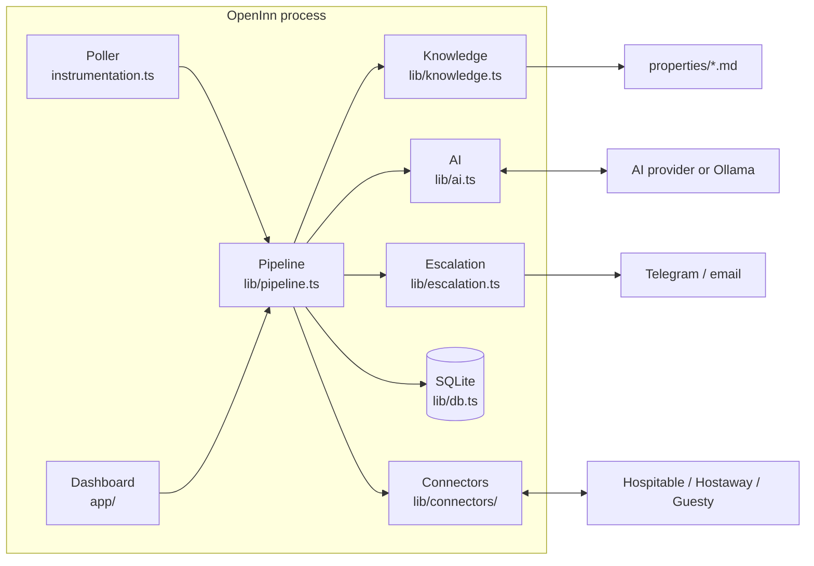

# Architecture

OpenInn is a single Next.js application. One Node.js process serves the dashboard and runs the background poller that reads guest messages from your PMS.



## Components

| Module | Responsibility |
|---|---|
| `instrumentation.ts` | Starts the poller once when the server boots (Node.js runtime only). |
| `lib/pipeline.ts` | The core loop: stores new messages, decides whether to reply, drafts, sends or escalates. |
| `lib/connectors/` | One file per PMS, each implementing the two-method `Connector` interface. |
| `lib/knowledge.ts` | Loads and validates `properties/*.md`. A broken file is skipped and reported. |
| `lib/ai.ts` | Picks the model from `AI_MODEL` and builds the prompt. Returns structured output: `reply`, `confidence`, `needsHost`, `reason`. |
| `lib/escalation.ts` | Sensitive-topic rules and Telegram/email alerts. |
| `lib/db.ts` | SQLite schema using Node's built-in `node:sqlite`. |
| `app/` | Dashboard: inbox, draft review and properties. Server components and server actions, no client-side JavaScript needed. |
| `proxy.ts` | Basic-auth protection for every dashboard route. |

## Message lifecycle

1. **Fetch.** Every `POLL_INTERVAL_SECONDS`, each configured connector returns recently active conversations for the listings that have a property file.
2. **Store.** Messages are inserted by their PMS id, and duplicates are ignored. Timestamps are normalised to ISO 8601 so ordering is reliable across PMSs.
3. **Decide.** OpenInn acts only if the **newest** message in the thread is new:
   - If it's from the host (you replied in the PMS directly), any pending draft is dismissed.
   - If it's from the guest and less than 24 hours old, a reply is drafted. Any older pending draft in that thread is superseded.
4. **Draft.** The AI gets the property file, the tone and the last 20 messages. The prompt tells it to use only facts from the property file and to ignore instructions inside guest messages.
5. **Escalate or send.**
   - **Escalate** if a sensitive topic appears in any guest message since your last reply, the AI sets `needsHost`, confidence is below the threshold, the reply is empty, or the AI call failed.
   - **Autopilot:** if nothing escalated, the reply is sent. If sending fails, the draft is escalated.
   - **Draft mode:** the draft waits in the dashboard and you get an alert.
6. **Send.** A draft is claimed atomically (`pending` → `sending`) before the connector is called, so a double click can't message a guest twice. If the send fails, the draft goes back to `pending`.

## Data model

```
conversations (id = "<connector>:<external id>", property_id, guest_name, updated_at)
messages      (conversation_id, external_id UNIQUE, role guest|host, body, created_at)
drafts        (conversation_id, message_id UNIQUE, body, confidence,
               status pending|sending|sent|rejected, escalated, reason)
```

`drafts.message_id` is unique, so each guest message gets at most one draft, even if polls overlap.

## Design decisions

- **Polling rather than webhooks.** Polling works behind home routers and NAT without exposing a public endpoint. Webhooks are planned for v1.1.
- **Markdown files for property knowledge.** Hosts can edit them in any text editor, keep them in git, and see exactly what the AI knows.
- **Keyword rules in addition to AI confidence.** Self-reported confidence from a language model isn't reliable enough on its own to decide what reaches a guest.
- **SQLite via `node:sqlite`.** No database server and no native dependency to compile.
- **One process.** It's simple to run and deploy, which suits hosts with 1–50 listings.
